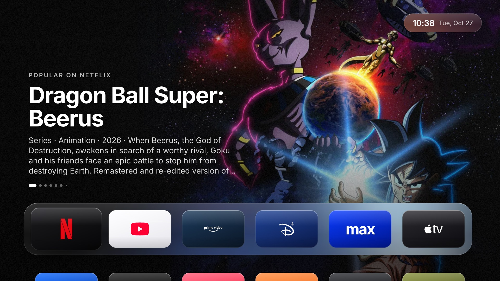
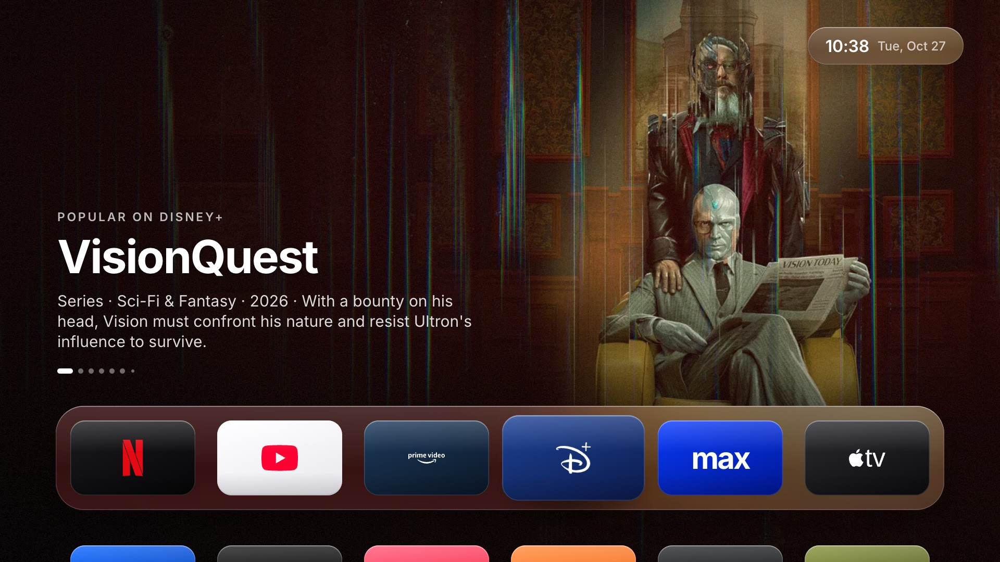
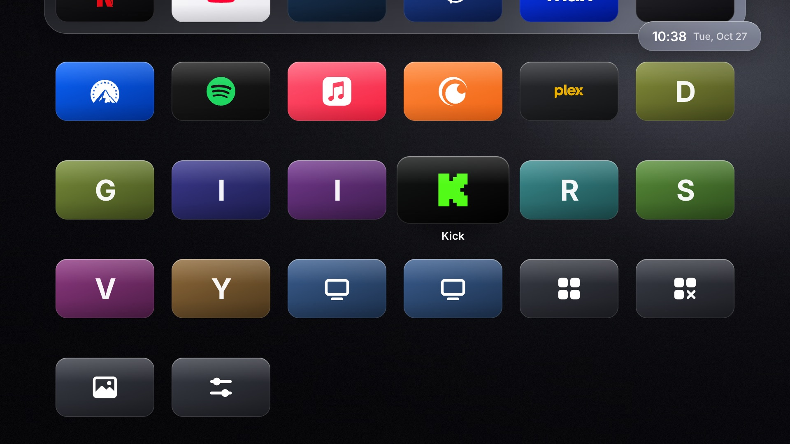
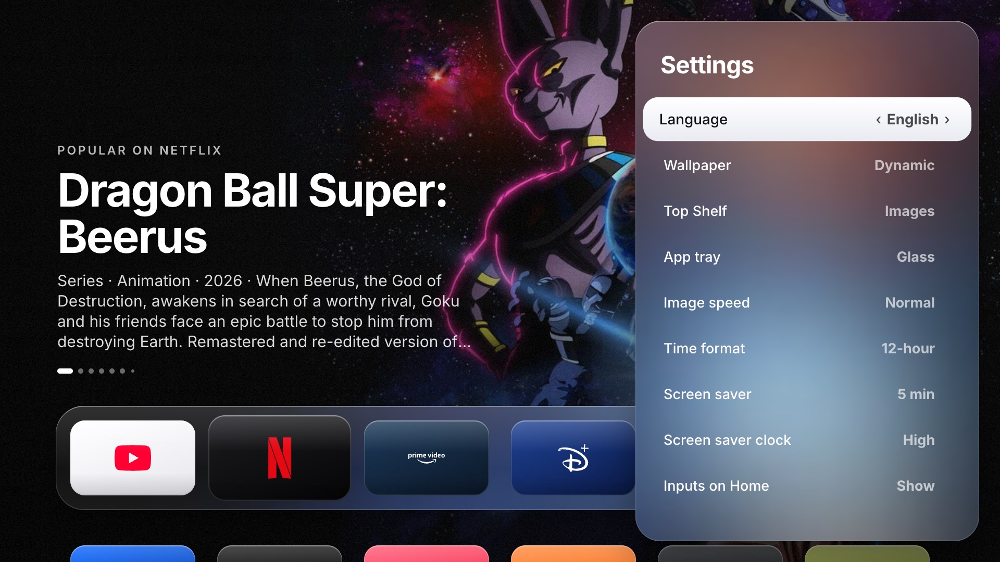
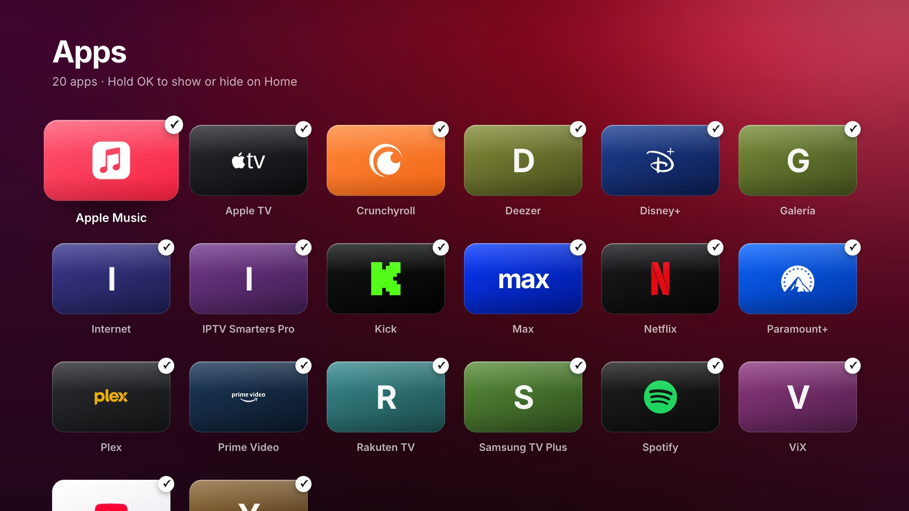
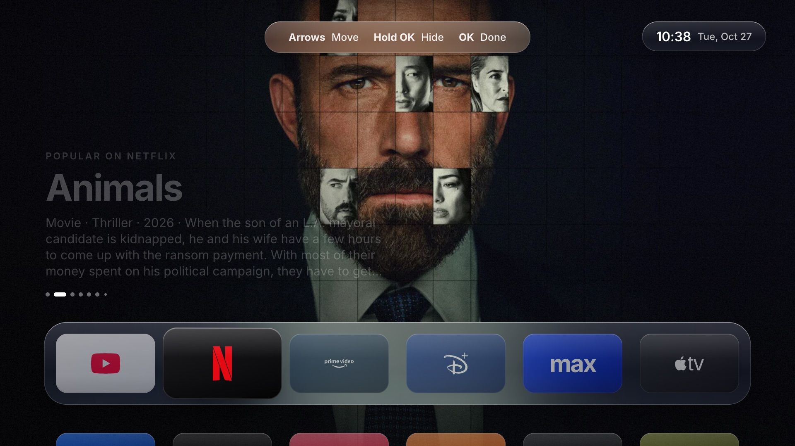
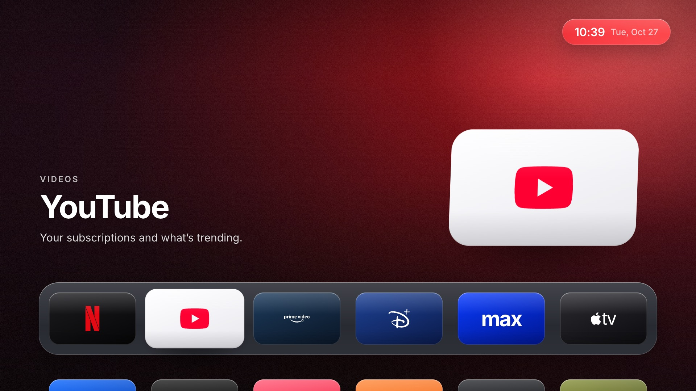

# Lumen

**A clean home screen for Samsung Tizen TVs, inspired by Apple TV.**

Lumen is a launcher app: it shows your installed apps in a simple grid, with big movie and show
images at the top, a clock and a screen saver. No ads and no store rows. It is made for **older
Samsung TVs** that feel slow or crowded, and it runs well on their old browser engine.



Read the story behind it: [How I cleaned up my Samsung TV and made it feel modern again](https://medium.com/@jhonosorio/how-i-cleaned-up-my-samsung-tv-and-made-it-feel-modern-again-a81cdd173563) · [en español](https://medium.com/@jhonosorio/c%C3%B3mo-limpi%C3%A9-mi-televisor-samsung-y-lo-volv%C3%AD-a-sentir-moderno-8d1bd5a9f928)

## Screenshots

| | |
|---|---|
|  Popular titles for each app (optional, with TMDB) |  All your apps, HDMI inputs and shortcuts |
|  Screen saver with the full description |  Settings, saved on the TV |
|  All apps: show or hide each one |  Hold OK to move or hide an app |
|  Classic mode (no TMDB key needed) | |

## Features

- **Grid like tvOS**: 6 apps per row. The focused app grows and tilts in 3D.
- **Top Shelf**: when you focus an app in the first row (Netflix, Disney+, Prime Video, Max,
  Apple TV, Paramount+, Crunchyroll), the top area shows its popular titles with a soft fade.
  This part is **optional** and uses [TMDB](https://www.themoviedb.org) (see below).
- **Glass look**: the old TV browser has no `backdrop-filter`, so Lumen makes the blur once on a
  small canvas. It looks like glass and it costs nothing when you move around.
- **Your order**: hold **OK** on an app to move it with the arrows or to hide it.
- **HDMI inputs** with names and logos (PlayStation, Xbox, Switch…).
- **Screen saver** with movie images, the full description and a big clock.
- **9 languages**: English, Spanish, Portuguese, French, German, Italian, Japanese, Korean and
  Chinese. By default Lumen uses the TV language. The country also comes from the TV.
- **Settings**: language, wallpaper, top area (images or classic), app tray (glass, translucent,
  solid or none), image speed, 12/24-hour clock, screen saver time and clock opacity, hidden apps.

Remote control: **Green** opens All apps, **Blue** or **Info** opens Settings, **Back** closes.

## Which TVs?

| TV | Status |
|---|---|
| Samsung 2018 (Tizen 4.0), e.g. UN43NU7100 | ✅ Tested every day |
| Samsung 2017–2020 (Tizen 3.0 – 5.5) | 👍 Should work. The code is made for the old Chromium 56 engine |
| Samsung 2016 (Tizen 2.4) | 🤷 Not tested |
| Samsung 2021 and newer (Tizen 6+) | ⚠️ Probably works, but the TV may ask for a Samsung certificate (see [Problems](#problems)) |

Lumen does **not** replace the Samsung home (Smart Hub). Samsung does not allow that. Lumen is an
app that you open, and you can leave it open. The Home button on the remote still opens Smart Hub.

## Install

You need a computer (Mac, Linux or Windows) on the same network as the TV, and
[Docker](https://www.docker.com/products/docker-desktop/) (on a Mac, [OrbStack](https://orbstack.dev) also works).
You do **not** need Tizen Studio: the script uses the Tizen tools inside Docker.

### 1. Turn on Developer Mode on the TV (only once)

1. Find the IP of your computer (for example `192.168.1.20`).
2. On the TV, open **Apps**. With the remote, press `1 2 3 4 5`.
3. Turn **Developer mode** on and write your computer IP in **Host PC IP**.
4. Restart the TV: hold the power button until you see the Samsung logo.

You can see the TV IP in **Settings > General > Network > Network Status > IP Settings**.

### 2. Install Lumen

```bash
git clone https://github.com/jacksonjao/lumen.git
cd lumen
sh scripts/install.sh 192.168.1.50
```

Change `192.168.1.50` to your TV IP. The script packages the app, signs it, installs it and opens
it. Lumen then appears in your TV apps. To update it later, run the same command again.

On Windows, run the command in **Git Bash** or **WSL**, with Docker Desktop open.

### 3. Optional: movie and show images (TMDB)

Lumen works without this. Without a key, the top area shows the app card (classic mode).
With a key, it shows the popular titles of each app in your country.

1. Create a free account at [themoviedb.org](https://www.themoviedb.org/signup).
2. Go to **Settings > API** and ask for a key (personal use). Copy the **API Key**.
3. Install with the key:

   ```bash
   TMDB_KEY=your_key_here sh scripts/install.sh 192.168.1.50
   ```

The key is saved in `src/js/config.local.js`. This file is in `.gitignore`, so it is never
uploaded to git. Next time you can run the install without `TMDB_KEY`.

About data: Lumen asks TMDB for new titles only every 12 hours (about 12 small requests) and saves
them on the TV. Moving around the screen does not use the internet.

## Try it on your computer

You need [Node.js](https://nodejs.org) 18 or newer. No `npm install` is needed.

```bash
node scripts/serve.mjs
```

Open http://localhost:8080 and use the arrows, **Enter** and **Esc**. Outside the TV, Lumen uses
example apps. Press **S** to open the screen saver.

## Customize

- `src/js/config.js`: the first order of the apps and the screen saver time.
- `src/js/brands.js`: colors, logos and texts for each app. To add a new logo, put the SVG in
  `src/img/marks/` and run `node scripts/build-marks.mjs`.
- `src/js/i18n.js`: all the texts in the 9 languages.
- `src/css/app.css`: all the design.

## Problems

- **"Could not connect to the TV"**: check that the TV is on, Developer Mode is on, and that
  **Host PC IP** is the IP of the computer where you run the script. Restart the TV after you
  change it.
- **Install fails with a certificate error** (common on newer TVs): create a Samsung certificate
  for your TV in [Tizen Studio](https://developer.samsung.com/smarttv/develop/getting-started/setting-up-sdk/creating-certificates.html)
  and package the `src` folder with it.
- **Lumen disappears after a reset**: apps installed in Developer Mode can be removed when you
  reset the TV or turn Developer Mode off. Install it again.

## Credits

- Movie and show data and images from [TMDB](https://www.themoviedb.org). This product uses the
  TMDB API but is not endorsed or certified by TMDB.
- Logos from [Simple Icons](https://simpleicons.org) (CC0) and Custom Brand Icons (MIT). All brands
  belong to their owners. Lumen is not related to Apple, Samsung or any streaming service.
- [Inter](https://rsms.me/inter/) font (OFL).
- The idea to filter system apps comes from [arn0-tv](https://github.com/NelsonEU/arn0-tv) (MIT).

## License

[MIT](LICENSE)
